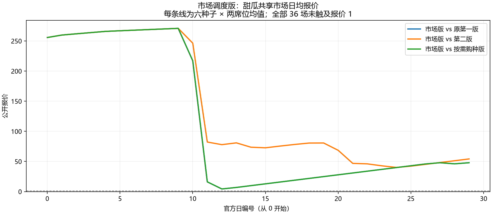
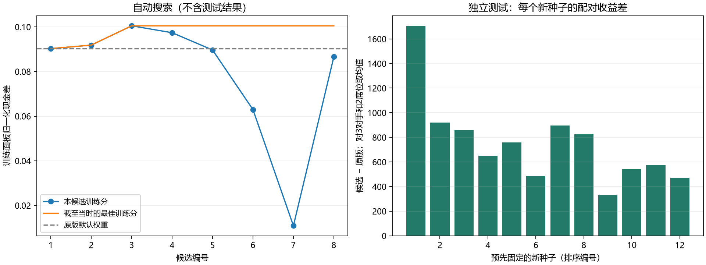

# 研发进展快照

更新日期：2026-10-18。官方规则不改，原第一版默认Bot保留。

## 手写策略冻结

市场版在原六种子上对三版、交换双方共36场：对第一版8胜4负，第二版0胜12负，按需购种版10胜2负；平均净收益40403.31。甜瓜全部36场报价未跌到1，但改善共享价格也可能帮助对手，不能据此声称全面更强。

## 自动参数实验

以原第一版控制器为基础，只自动调整4个作物评分倍率。8次候选×8场完整比赛＝64场训练；候选选定后再打开12个新种子，对3个冻结对手交换双方。原版与候选各72场，共144场独立对照。

| 策略 | 胜/平/负 | 平均净收益 |
|---|---:|---:|
| 原版 | 48/24/0 | 38867.06 |
| 自动候选 | 72/0/0 | 39619.10 |

原版24平是原版镜像自战；候选对原版24场全胜。配对平均收益增加752.04，约1.93%；按12个种子聚类bootstrap的95%区间为585.54～964.28。每个种子的平均收益差均为正。只能支持当前面板内的小幅提升，不能推出公开比赛水平。

最佳候选来自启动采样；后续TPE建议未超过它，不能声称本轮验证了TPE优于随机搜索。

## CPU与GPU边界

顺序官方完整比赛约0.44场/s；加双方审计和gzip回放约0.31场/s。CPU热点主要是状态深拷贝和结构转换。正式实验只用两个本地CPU worker。

独立GPU探针从真实冻结教师胜局提取1680个成功种植样本，43维输入、128隐藏单元、5作物输出。按整种子划分训练/验证，CPU和CUDA GPU各完成512次计时梯度更新，权重变化、loss下降。验证分类准确率约88.8%。

该网络没有接入Bot。参赛候选来自CPU参数搜索；小型网络的GPU计时不能当成游戏仿真、完整训练或大模型的加速倍率。

## 扩展独立评估：没有确认稳健提升

评估前已公开登记种子、源码哈希和验收标准（提交 `c1d63f3`）。冻结同一候选，12个全新种子，对第一版、第二版、按需购种版和市场版交换双方；基线与候选各96场，共192场。另2场逐场复现不计入统计。

| 策略 | 胜/平/负 | 平均净收益 | 平均比赛得分 |
|---|---:|---:|---:|
| 原版 | 56/20/20 | 37825.27 | 0.6875 |
| 冻结候选 | 66/0/30 | 37956.60 | 0.6875 |

整体配对收益差+131.33，95%种子聚类区间[-341.21,574.63]。对市场版原版8胜16负、候选10胜14负，但配对收益差-18.46，区间[-648.42,498.04]。对按需购种版原版22胜2负，候选16胜8负。不能根据总胜场增加认定变强。

官方完整运行与复现验收通过，预登记统计提升门槛未通过。旧面板的小幅正结果仍是历史结果，但新面板未确认其泛化；没有据此修改策略、默认Bot或开启PPO。全部194份本地Replay已核对终局、日志、双方审计与语义哈希，4份HTML样例留在本地。

[中文详情与复现命令](../kaggriculture/HOLDOUT.zh-CN.md)、[匿名逐场账本](evidence/holdout-20261018/ledger.json)、[登记及证据目录](evidence/holdout-20261018)。先登记提交提供可核对的先后顺序，不是对全部历史未调参的绝对证明。

## 下一阶段

第二轮完成后转向完整机制基础，见最新阶段。下一次优先补多机制示范采集、执行标签与联合资源上下文，再接入有限BC；不再连续追加四参数搜索，不进入PPO或自动晋级默认Bot。公开测试种子以后只能作开发回归。

## 第二轮：多对手参数优化

登记提交 `855042b` 先固定8候选、3个已公开开发种子、四个对手及12个新测试种子；只调整原来的四个作物评分权重。开发目标为双方席位聚合后相对现金差的均值减0.25倍标准差，共192场。第7次候选入选，开发目标0.03517495，高于旧候选0.03325669。提交 `6dd6da7` 在测试前冻结了唯一候选及完整选择记录。

独立测试288场，原版、上一轮候选和新候选各96场。原版52胜20平24负、平均净收益40047.14；旧候选69胜27负、40409.52；新候选78胜18负、40619.02。

新候选相对原版：整体配对收益+571.89，95%种子聚类区间[339.82,870.23]；对市场版+486.75，区间[137.58,876.09]。相对旧候选：整体+209.50，区间[-443.87,1013.73]；对市场版+134.00，区间[-488.01,827.86]。新候选对市场版6胜18负，旧候选8胜16负，平均比赛得分下降。

因此运行验收通过，预登记总提升门槛未通过。相对旧候选，12个种子仅4个配对收益为正、8个为负，不能用平均值或总胜场增加认定稳健提升。482份本地回放已核对，两场重复对局的余额和语义哈希一致；6份HTML样例与原始日志只留本地。公开有开发/测试逐场账本、全部8组参数、冻结模型、源码映射和独立复算记录。

[中文说明与复现命令](../kaggriculture/ROUND2.zh-CN.md)、[证据目录](evidence/round2-20261018)。相对原版改善的结论限定于本轮固定面板；没有等预算随机搜索对照，没有GPU训练、PPO或默认Bot切换。

公开证据是匿名汇总，未附原始Replay，因而完整轨迹级验收需要复跑。这是公开范围限制，不应被包装成外部独立复核已通过。

## 完整机制与学习接口基础

初始HEAD为2253662，工作区干净；核对本机官方1.33.0与固定f994f205提交的规则字节一致。对动作解析、资源与时序、观测、胜负建立12族机制覆盖表。冻结作物教师仅9族部分覆盖，扩地/动物/施肥3族无决策分支；不是优化证明它们无价值。

新增decision接口保留合法单玩家信息、全地图/单位/物品、保序背包、市场/城镇/时间与公开历史；支持完整18单位+6市场类别。Policy可直接输出Joint，冻结教师不是永久门禁。孤立前置条件有官方正反例，联合执行/报价依赖明确为conditional，尚无完整联合精确mask。29个机制用例通过，包含动物三物种产出/逃走、施肥、三次购地、订单锁步、负库存可购买、日终与终局、数量转换与完整运行隐私隔离。

初始登记a4a1661后发现codec错误拒绝官方int()可接受的float数量：24场control与2场parity完成、24次land尝试中断。9ef19f2在补跑前公开修订兼容逻辑，不改策略/种子/门槛；保留原始失败，复用已完成对照，只补24场land和2场复现。该恢复批次不称为全新未见测试。

单一反事实是冻结第二轮控制器step0买一次NE，其余不变。6种子、第一版/市场版、双席位，共48场评价，另4场parity/复现。land对市场版12胜0负，对第一版0胜12负；control分别2胜10负和12胜0负。整体配对自身收益+6947.75，bootstrap区间[625.00,11589.25]，但比赛得分下降0.0833，因此探索门槛未通过。仅6种子，不能拿收入区间或分组胜率宣称普遍升级。

52份回放37388次转移已用官方引擎逐步复演，两边公开/私有状态及结果一致；确认1274次新地实际播种、每对首回合成本1000。24/24对城镇序列分叉，效果包含官方共享RNG和对手响应，不是纯面积收益。旧作物审计器不泛化动物，新full_audit直接复演官方动作；一只鹅的独立Policy通过全局经营链及719次转移复演，售54蛋/29肥料，现金7150，对PASS仅为执行样例。新多文件启动入口decision.play实测完整对局并与实验轨迹一致；不改旧Play.ps1、默认或冻结候选。

[机制表](../kaggriculture/decision/MECHANISMS.zh-CN.md)、[架构](../kaggriculture/decision/README.md)、[实证](../kaggriculture/decision/EXPERIMENT.zh-CN.md)、[学习路线](../kaggriculture/decision/LEARNING_ROADMAP.zh-CN.md)、[脱敏证据](evidence/mechanism-foundation-20261018)。当前没有BC部署、DAgger或PPO训练；GPU用途仍是此前独立小型探针。

## 2026-10-18：审计与执行基础修复

基于 428448a 的 WebChat 审查，新增带版本的背包保序比较/哈希、官方逐原语效果归因和运行器管理的 HistorySession。保留 v1 字段和所有历史产物。15 项针对性回归、29 项原机制测试；52 场最终代码逐步复演的版本绑定与结果见 [验收](evidence/audit-repair-20261018/acceptance.json) 和 [逐场证书](evidence/audit-repair-20261018/official-reexecution-v2.json)。

市场标签目前为订单聚合和成交交错摘要，不是完整联合 mask；HistorySession 每局必须 reset。原生动物 PLACE 忽略数量的兼容边界已加入回归。第一次补充场景构造被本地 codec 拒绝、后续观察器数量解析反例的失败均留本地，公开只输出通过的最终结果。策略、默认 Bot、候选、旧账本及旧哈希保留；扩地仍不晋级，本轮不做 BC/PPO/GPU 训练。详见 [实现与边界](../kaggriculture/decision/AUDIT_REPAIR.zh-CN.md)。

## 执行审计复审后续修复

针对 a938ef8 的三项已复现缺陷，修复非列表 hands 的追踪透明性、已有动物设施的部分入库归因、优化器遥测错误导入官方引擎。标签版本为 2，语义审计版本仍为 2。29 项机制测试、17 项审计回归和隔离遥测入口验收，另生成新一轮 52 场官方逐步复核证书；历史收益、策略与默认 Bot 保留，不做 BC。详见 [修复、命令与边界](../kaggriculture/decision/AUDIT_FOLLOWUP.zh-CN.md) 和 [本轮证据](evidence/audit-followup-20261018)。验收结果以 acceptance.json 为准；不是新独立比赛或策略提升证据。

## 遥测消费层修复

后续复审发现遥测后处理仍直接展开非列表 hands。本轮只修消费层，明确“执行前实际单位槽位的非 PASS 请求”口径，保留旧字段为兼容别名；不把请求数当成功执行数。新增双方席位、有无工人的 4 场完整官方边界对局，经 8 次生产隔离遥测验证；旧 52 场分别完成官方逐步复演及全部生产遥测复核。历史证据不覆盖，不改策略或默认 Bot，不做 BC。详见 [修复说明](../kaggriculture/decision/TELEMETRY_REPAIR.zh-CN.md)、[验收及新证书](evidence/telemetry-repair-20261018)。

## 第一代教师扩展：持续作物施肥

从机制审计选择施肥运输与及时收获，先完成 4 场官方单地块验证，再做 16 场开发赛；登记新种子和门槛后冻结唯一候选，独立面板 72 场加 2 场复现。候选 36 场 28 胜 8 负，第二轮基线 9 胜 10 平 17 负；平均净收益 +3340.58，六种子聚类 95% 区间 [2567.67,3930.97]，整体现金差 +3359.56，三个对手平均得分均未下降。探索性竞争门槛通过；正式执行验收及机制次数以 [证据](evidence/teacher-fertilizer-20261018/acceptance.json) 为准。原版本和默认 Bot 保留，不做 BC。详见 [教师策略、局限与复现](../kaggriculture/TEACHER_FERTILIZER.zh-CN.md)。

## 终局施肥教师修正

登记 c6505d4，测试前冻结 b98cc9d。新增终局窗口教师；5 项边界回归、29 项机制回归、12 个历史零生产案例检查通过。新面板 96 场加 2 场复现，净收益差 +86.875，种子聚类区间 [18.9583,183.1667]，符号检验 p=0.125。正式执行验收见 `evidence/teacher-terminal-v2-20261018/acceptance.json`；旧版/默认与历史证据保持不变，未做 BC。

## 2026-10-19 施肥/及时收获消融

登记4fd6482，冻结1160751。144场新种子多对手双席位比赛+4场复现，148场官方逐步复演通过。F−B=-3079.14，FH−F=+6382.33，FH−B=+3303.19；H与B全回放语义一致，是依赖肥效的阴性对照，不代表无肥收获普遍无效。146个历史保护文件不变，未做BC、不改默认。详见 `kaggriculture/FERTILIZER_ABLATION.zh-CN.md` 与 `review/evidence/fertilizer-ablation-20261019/`。

## 2026-10-19 冻结策略收益归因

测试前登记及冻结 a544faf，三组冻结策略、六个新种子、三对手双席位，共108场正式赛加4场复现。112场80528次官方转移逐步复演一致，现金账与销售分解通过，164个历史保护文件不变。FH−F净收益+5370.81；持续作物每局截断28.58→0.06，销量项是主要收入渠道，但甜瓜价格改善与草莓/番茄降价部分抵消。任务安排仅有描述性证据，不分配独立因果利润份额。默认/策略未改，未做BC或GPU训练。

详见 [收益归因报告](../kaggriculture/PROFIT_ATTRIBUTION.zh-CN.md) 与 [脱敏证据](evidence/profit-attribution-20261019/)。复审重点：生产hook透明性、单位动作计数、销量/价格的逐配对分解、现金恒等式、独立种子与原版本保护，以及描述性中介证据是否被夸大成因果结论。

## 2026-10-20 收益归因消费者兼容性修复

单位动作和市场订单共用安全的操作码读取视图，保留原始载荷及官方状态，不把异常动作计作PASS或成功。50个双席位异常入口场景、2场完整边界对局、有效经营与原生异常传播检查通过，17项既有审计回归及6项生产边界检查通过。旧112场80528次官方转移全部重新复演，新证书逐场审计和归因字段与旧证书一致；用新证书重跑原分析器，全部归因字段相等。旧实验488个文件、默认及运行时策略原哈希保持不变；没有新策略实验或BC。

详见 [修复和验证说明](../kaggriculture/decision/ATTRIBUTION_CONSUMER_REPAIR.zh-CN.md) 与 [新证书及来源](evidence/attribution-consumer-repair-20261020/)。复审重点：两分支类型防护不改写原始事件；官方入口→真实追踪器→消费者回归；失败与部分成交计数；旧112场完整复演和代码绑定；历史哈希保留、私有状态隔离与公开证据边界。

## 市场择时 V1 开发止步（2026-10-21 开始）

新增 `bots/teacher_market_v1.py` 研究候选；仅改 SELL，默认及冻结教师保留。32 场开发赛、另 1 场官方文件入口复现通过，共 23727 次官方逐步复演。非镜像平均净收益 +67.67（约 0.17%），两个种子差值 −81、+216.33；开发门槛未通过，未运行192场留出测试，不晋级、不做BC。文件入口别名修正保留开发原 SHA，23008 观测与真实文件对局验证动作等价。见 [市场候选结果](../kaggriculture/TEACHER_MARKET_V1.zh-CN.md) 和 `review/evidence/market-teacher-v1-20261021/`。

## 2026-10-23 市场审计计数层与比较器兼容修复

共用只读安全操作码视图，保留异常订单的原始载荷和位置；计数明确区分请求、成交、解析拒绝与超限忽略。22个双席位异常场景、3组比较器检查、2场完整官方入口回归，以及原消费者50场景/2场完整回归和23项市场边界通过。原32场开发赛与1场入口复现全部重新复演，共23727次官方转移，新证书逐字段等于旧记录，账目及统计相同。保留旧证书、177份原市场产物、14份策略和默认入口；不跑192场预留测试，不晋级，不做BC。详见 [修复口径与复现](../kaggriculture/decision/MARKET_CONSUMER_REPAIR.zh-CN.md) 和 [新证书](evidence/market-consumer-repair-20261023/official-reexecution-v3.json)。

## 2026-10-23：有限选种 BC 闭环完成

冻结提交 `5778dda14720ef86bd17ed7cfd7a01874d6fdc15` 之后完成 144 场留出比赛；累计 218 场官方完整比赛和 156,742 次保序复演。60 场示范含 11,483 个选种决策；CUDA 实际训练并部署 CPU 推理。工程 A、模仿 B 通过：学生净收益比初始模型 +10,815.54，95% 种子聚类区间 [8,837.04,12,852.92]；比教师 −2,280.44，仍有明确差距。默认、旧策略与历史证书保留，未启动 DAgger/PPO。[中文结论](../kaggriculture/BC_CROP_V1.zh-CN.md)、[证据](evidence/bc-crop-v1-20261023)。

## 2026-10-23：BC 准备入口修复

新增显式种子准备入口，区分新留出实验与历史复现；保留旧冻结实现。9 项回归验证配置、历史使用检查、防覆盖及历史报告不冒充新独立证据；不训练、不新增比赛，不改变原收益结论。[说明](../kaggriculture/learning/bc_crop/PREPARATION_REPAIR.zh-CN.md)。

## 2026-10-23：有限选种 BC 开局误差诊断

冻结模型不变，先重建62场既有轨迹，再完成两个新开发种子、三冻结对手、双席位的36场官方比赛及25884次保序复演。单一教师纠错探针比原学生平均净收益+2239，两种子均正、市场对手+448.5；仅支持继续调查，不是新学习型Bot或显著性证据。52次纠错均在step12–16，44次输入已在原训练出现。无重训、默认Bot不变、未进入DAgger/PPO。见[诊断报告](../kaggriculture/BC_DIAGNOSTICS_V1.zh-CN.md)与[登记和证书](evidence/bc-diagnostics-v1-20261023/)。

## 2026-10-23：输出层微调 V1 负结果

单次720次GPU更新完成，但20个训练后epoch的开发CE均不优于原模型，预登记选中epoch0，离线门槛失败。0新比赛，预留14场未运行，默认及原模型保留，没有换参数补考。只保存选中epoch0，不能判断未选epoch的草莓纠错效果。独立子代理复算通过；下一步先做零更新诊断。见[结果报告](../kaggriculture/BC_HEAD_V1.zh-CN.md)及[证据](evidence/bc-head-v1-20261023/)。

## 2026-10-23：输出层零更新诊断

0训练、0更新、0比赛，固定原模型分析20个目标及36批局部方向。加权/未加权训练梯度均与开发验证总体同向，不能把旧失败归因于目标冲突。36批理想首步Adam有27个验证下降方向、9个上升，不能冒充真实连续轨迹。独立审查修复了76个加权曲率的float32分母口径，原结果/冻结保留，最终消费corrected结果；预测和其他统计不变。隐藏计数的末位数值分裂已单独核查，不证明或否定线性可分。见[中文结论](../kaggriculture/BC_HEAD_DIAGNOSTICS_V1.zh-CN.md)与[证据](evidence/bc-head-diagnostics-v1-20261023/)。

## 2026-10-23：全批次输出层 V1，离线失败停止

一次真实GPU训练，20次全量更新，保留全部21头。严格CE选中epoch6：验证CE0.390507、准确率88.115%，固定160错误剩112，高于80上限。新比赛0，原14场不运行；默认及原模型未换，未改选epoch11/20或追加训练。独立复算21头/504组指标通过。后续拟另行登记固定epoch6的经济诊断准入例外，0训练、最多48+2新开发比赛，不追认旧门槛通过或自动晋级。见[报告](../kaggriculture/BC_HEAD_FULLBATCH_V1.zh-CN.md)、[证据](evidence/bc-head-fullbatch-v1-20261023/)。

## 2026-10-23：固定第6步模型经济诊断

事前提交9cb47cd，明确新诊断准入例外，旧离线失败和零比赛保持不变。0训练，4新开发种子、3对手、双席位、两模型48场加2入口全部完成，主审计50场各双复演71900次转移，独立抽验4场5752次。第6步相对原学生平均净收益+1237.42（3.30%），14胜10负→16胜8负；4种子均正，但市场8配对完整轨迹相同、没有改善。仅开发探索门槛通过，不晋级、不改默认，不追认旧门槛。见[报告](../kaggriculture/BC_ECONOMIC_EPOCH6_V1.zh-CN.md)及[证据](evidence/bc-economic-epoch6-v1-20261023/)。

## 2026-10-23：固定第6步学生独立留出验收

事前登记2fe5b08，8新种子、3对手、双席位、两固定模型96场，另2入口复现；0训练。整种子20,000次bootstrap，净收益+1433.40（3.67%），95%区间[768.38,2064.31]，22胜26负→30胜18负，预登记研究基线门槛通过。一个种子−144.50，市场16配对完整轨迹相同，不声称全面改善或超越教师。主98场双复演140924步，独立预选4场5752步及全部统计复算；默认/原模型/历史失败不变。下一步仅规划联合任务示范与可接管接口，未训练。见[报告](../kaggriculture/BC_EPOCH6_HOLDOUT_V1.zh-CN.md)与[证据](evidence/bc-epoch6-holdout-v1-20261023/)。

## 2026-10-23：联合任务选择示范与接口 V1

事前1d43efc，0训练/0新完整比赛。新任务回调能选工人+地块+操作，保持独立作物选择；原60示范完整动作等价及43140次官方旧复演通过，重建135406任务样本，五类两split及跨类竞争结构覆盖通过。6固定合成对照12新官方step验证直接控制及实际多单位预留。独立全部180文件/135406行消费复算、预选2旧game1438复演、8682候选850836特征值核查通过。预审发现并在执行前修复框架计数不同步，旧freeze/review保留。类别不平衡、候选教师门控、组合epoch6未完整验收仍需披露；无新模型/收益结论。见[报告](../kaggriculture/TASK_CHOICE_V1.zh-CN.md)、[证据](evidence/task-choice-v1-20261023/)。

## 联合任务 BC V1：训练完成、文件入口验收失败

事前20b2154，原60示范135406组，单次GPU8轮3392更新，最低合格验证CE选任务epoch6，多候选ID命中93.97%，全验证CPU重载ID零分歧。12场已消费验证种子开发比赛完整结束，训练头平均净收益33718，混合参考33873（差−155），均4胜；不能声称超越教师或新留出泛化。首官方filename入口因wrapper依赖未提供的__file__加载失败，第二入口未启动，整体stage_acceptance=false，保留所有失败和停止事实。主12场8628官方复演，独立两场1438；独立全账本/9头指标复算通过仅证明证据一致。下一步只另登记入口兼容修复、最多2原seed历史复现，不重训/重跑面板/default不变。见[报告](../kaggriculture/TASK_BC_V1.zh-CN.md)、[证据](evidence/task-bc-v1-20261023-run1/)。

## 联合任务学生官方文件入口修复 V1

事前登记1879904，只新增co_filename兼容包装器和独立修复入口，旧task_bc源码/模型不变。真实官方旧错误反例及新官方/Worker/direct连续2步动作与完整trace一致；两场原seed历史filename比赛均720/719/DONE、零错误，全部动作/trace/v1v2/现金等于旧trained双席。主1438官方复演，独立再1438及2876双方动作/1438trace比较通过。旧3274runtime保留；旧679public仅两review追加，其余677原字节。0训练/0新增经济样本，旧stagefalse和−155开发均差不变；修复通过不等于模型晋级。下一步独立建议另登记固定双头8新seed多对手96场能力保留评估，当前未实施。见[修复报告](../kaggriculture/TASK_ENTRY_REPAIR_V1.zh-CN.md)与[证据](evidence/task-entry-repair-v1-20261023/)。

## 固定任务学生新种子能力保留评估：执行通过、准入失败

事前221f9dc，固定任务头＋固定选种头对规则任务＋同选种头，8新seed×3对手×双席×两臂96官方filename完整赛，0训练/更新/重选。平均净收益39334.96对39755.15，差−420.19（−1.05694%），8整seed20k bootstrap相对95%区间[−1.57668%,−0.48132%]；虽通过−2%工程容忍主门槛，但round2得分差−0.25低于−0.05，整体准入失败。28胜20负对参考32胜16负，round2从10胜6负到6胜10负；不能称进步或默认晋级。主全96复演69024步，独立全账本/统计、预选四场2876步；3335旧runtime、703旧public审查时原字节，发布仅两review追加其余701同。原失败/default/模型不变，种子已消费不可补训后复用为独立测试。见[报告](../kaggriculture/TASK_BC_HOLDOUT_V1.zh-CN.md)、[证据](evidence/task-bc-holdout-v1-20261023/)。

## 固定任务学生误差诊断 V1：超时停止，未完成诊断

事前5f5f17d，0训练/新比赛/官方步骤。原96场69024回合库存核验通过，215546事实任务选择、11187318候选；support任务在900秒上限超时，未持久化完整索引/评分，0影子策略调用、0重试，诊断及阶段验收false。父子截止错误和已观察四个Windows启动器/解释器全部退出均经独立复核；这不等于通用进程树关闭保证。4822旧runtime和739旧public终态原字节，发布只追加两review入口；旧任务学生统计准入失败、默认及模型不变。下一步只计划分段支持/评分的有界容量验证和真实Windows退出回归，先不重跑全量、不改网络或训练。见[失败报告](../kaggriculture/TASK_BC_ERROR_DIAGNOSTICS_V1.zh-CN.md)与[证据](evidence/task-bc-error-diagnostics-v1-20261023/)。

## 任务诊断容量 V1：准备停止，失败证据保留

基于123cfe0，本地准备登记与独立源码审查先于执行。四类真实Windows生命周期及33项合成回归通过；1280历史前缀、73750候选参考与1024训练样本索引完成。第二评分分片虽然返回0并写完成收据，退出时仍触发强制Job清理，父调度器按门槛停止；29.344秒，7尝试/6接受，2/10分片有产物但仅1/10获父接受，无完整汇总/比较/正式容量运行。1536评价88500候选不退款，实际score384次22125候选；训练样本仅128数值unique，不能外推全量吞吐。独立审查确认失败证据，具体残留身份和是否退出尾部未知；0训练/影子/新赛/official，旧准入false/default/model不变。下一步只另立正常退出后有界等待修复与实际回归，不直接重跑96面板。见[报告](../kaggriculture/TASK_DIAGNOSTICS_CAPACITY.zh-CN.md)及[证据](evidence/task-bc-diagnostics-capacity-v1-20261023/)。

## 任务诊断容量正常退出修复 V1：样本验收通过

事前提交73e1eaa，新增root返回0后最多2秒whole-Job自然退出等待，仍受原工作截止及同一次10秒清理上限约束。7项真实Windows用例全部符合预期，14任务29.453秒，重建1024训练索引、10新分片1280行/73750候选，与旧参考逐行及完整摘要一致。独立全量只读比较、14私有/公共生命周期及预算核对通过，5259旧runtime和811既有public审查时原字节；最终发布仅两review入口追加。累计预算2816/162250，旧失败不退款。实际worker均root时已空，等待分支仅由targeted fixtures证明，旧失败具体原因仍未知。样本只有128数值unique及PLANT/WATER，不能外推全量或模型质量；0训练/新赛/official/default不变，旧三项false保留。见[报告](../kaggriculture/TASK_DIAGNOSTICS_CAPACITY_EXIT.zh-CN.md)及[证据](evidence/task-bc-diagnostics-capacity-exit-v1-20261023/)。

## 分层历史任务诊断：评分一致，报告比较失败

事前f7b57f2，20旧示范按时段和五类标签稳定抽取514组/32366候选，412训练/102验证。两路径compact逐条和summary字节相同；47任务46接受，59.562秒，最后report因整数键与JSON字符串键排序误判停止，阶段false。12小回归40/80通过，47树自然关闭，0训练/新赛/官方步骤。评价1028/64732、累计3844/226982不退款；135363原流物理行与514数值解码分列，5489历史stat不冒充全字节复核。独立审查已定位真实比较反例，旧模型/default/失败不变。后续仅另登记compact报告修复，尚不代表模型改善。见[失败报告](../kaggriculture/TASK_BC_STRATIFIED_ERROR_SAMPLE_V1.zh-CN.md)及[证据](evidence/task-bc-stratified-error-sample-v1-20261025/)。

## 分层报告比较修复：实际入口通过，审查例外透明保留

事前1f04b98，新输出下8回归和514 compact报告一次完成，1.547秒，0新评分/数值输入/原始流/训练/比赛，累计3844/226982不变。整数JSON键严格比较保留真实差异、字段和数组顺序；来源/修复冻结分开，6581历史stat不变。独立514遍历已核6边际/30格与首个见证，但审查器误要求恰好5而非至多5，原attempt及完整120s复审门槛仍false。另登记0compact元数据纠正0.094秒通过，root据已核数据有条件关闭具体报告缺陷，不宣称原严格审查或全阶段无条件通过。训练412中5分歧、验证102中5分歧，全10涉及地块，4类首见证；仅历史条件描述，不能解释原净收益下降。见[报告](../kaggriculture/TASK_BC_STRATIFIED_REPORT_REPAIR_V1.zh-CN.md)、[证据及审查例外](evidence/task-bc-stratified-report-repair-v1-20261025/)。

生命周期措辞澄清：上文分层阶段的“47树自然关闭”应按原证据理解为47树均已关闭、0强杀，其中46个成功任务满足natural_tree_exit；失败的报告任务只证明非零退出、无强杀且树已关闭，不能称其达到成功自然退出门槛。此澄清追加保留原历史文字和证书。

## 学生实际任务历史诊断 V1：执行与分解通过，尚无收益归因

事前8b12cab，固定一个已消费seed、三对手双席六条trained轨迹，单次压缩哈希＋gzip读取，4314turn/12232callback/575674candidate/920crop；547988954返回payload，非零输入JSON解码但0模型/重建/策略/official/训练/新赛。6合成＋2收据失败回归通过且所属temp已移除；8job自然关闭，最终11.516秒在原600秒内验收。独立预写checker单遍12232compact、0.219秒，重算投影及统计，不冒充第二遍raw复现。
236条件候选分歧中op122/unit130/target212重叠，首见证六个均step15 WATER→WATER、工人及地块不同；三个对手各自双席汇总相同，不当独立样本。HARVEST→WATER52、FERTILIZE→WATER22仅检查线索，不是失败执行或收益损失。独立人工仅六见证，不追加raw/compact；报告两处过大措辞已修正。6623历史stat保留、133源与138预提交清单绑定，模型只继承hash＋stat；旧准入/旧诊断/前轮strictreview false不变。下一唯一问题是同一事实观测及预留下首分歧是否改变完整单位请求，尚未执行，不据此重训。见[报告](../kaggriculture/TASK_BC_SAVED_STUDENT_DECISIONS_V1.zh-CN.md)与[证据](evidence/task-bc-saved-student-decisions-v1-20261026/)。

## 首个 WATER 分歧的单位请求实验：六例均相同

事前1b9429e，固定同一已消费seed的三对手双席step15，只执行6基线＋6单点干预。全部基线先完整复现历史语义trace；在原事实上下文选择一次当前合法教师WATER，后续学生重新枚举/评分。6例均只是相邻两项WATER分配顺序交换，完整7单位请求逐项相同；不表示其余236处分歧无害、market/官方/未来/收益相同。0训练/新赛/official，旧准入和失败状态不变。

连续阶段2.750秒内验收，2job自然关闭，4内存协议检查通过。6源只读16行前缀、解码6目标：压缩2776875字节、返回payload29645728、目标JSON1142873；gzip内部未返回缓冲6项unknown保留，无失败unknown，完整trace哈希只继承。两模型各原SHA及加载一次，文件返回读取783840字节；72编码观察1344候选，任务66前向1140候选、作物36前向180logit值，累计task3910/228122。独立机器只读117655字节新收据，独立人工另读6pair共101078字节，无第二原始/模型复现；140源、145提交绑定及6735旧stat核对通过。见[报告](../kaggriculture/TASK_BC_FIRST_WATER_UNIT_REQUESTS_V1.zh-CN.md)与[登记、证据和独立复审](evidence/task-bc-first-water-unit-requests-v1-20261026/)。

## 首个操作类别分歧的单位请求实验：一例相同

事前 608e95d，固定已消费历史来源 v1／席0／seed1714414373。唯一选择器单次校验完整 compact 的 923156 字节，仅解码至首操作分歧的 665 条；选中 step225／零基回调2，学生 FERTILIZE、条件教师 WATER。先精确复现原完整语义 trace，再只替换这一次当前合法选择；后缀原学生重新枚举评分。相邻两次分配交换，下一回调候选25→28，回调4起重合，完整6单位有序请求相同。只说明这一例分类分歧没有改变单位请求，不推其他分歧、官方执行、市场、未来收益或教师优劣。

连续可执行1.813秒，3job自然零退出／句柄闭合，5内存协议检查通过；1源读226行只解码1目标，压缩2219946字节／返回payload29110296／目标236985。完整trace hash只继承，1项内部未返回缓冲unknown保留、失败unknown0。两模型各hash/load1次，实际读取783840字节；12回调/编码、423生成候选、11任务前向383候选，作物前向0，累计任务3921/228505。机器单遍新收据103110字节，独立子代理单遍selection/pair96182字节、205.610秒通过；root22.765秒安全元数据裁决通过。147源及152提交项原字节、6782历史stat保留；最终执行输出1275133<2097152。0训练／新赛／官方步／GPU，旧准入及失败状态不变。见[报告](../kaggriculture/TASK_BC_FIRST_OPERATION_UNIT_REQUEST_V1.zh-CN.md)与[登记、证据、独立复审](evidence/task-bc-first-operation-unit-request-v1-20261026/)。

## 教师单标签等价性 V1：前置测试失败，未进入样本实验

本轮没有得到标签等价性的正例或反例。唯一一次执行停在第一个内存 gzip 协议测试，原训练文件、Replay、教师控制器和模型均未进入执行。保留失败，不重跑这份冻结版本，不用此前单位请求相同的结果替代本轮尚未完成的完整动作比较。

主代理另在 180 秒上限内用 0.250 秒核对安全收据、154 份运行／公开源码、159 个 Git 原字节绑定、6,842 个历史 stat、模型 stat 和默认 Bot SHA；未读取 case、原样本或模型。裁决仅关闭这次失败阶段，并确认没有可接受的标签实验结果；不覆盖独立复审的计时例外或旧失败。公开证据仅含脱敏摘要及原哈希，原日志、进程身份、私有 case、模型和 Replay 留在本地。

[Report](../kaggriculture/TASK_BC_TEACHER_LABEL_EQUIVALENCE_V1.zh-CN.md) | [Evidence](evidence/task-bc-teacher-label-equivalence-v1-20261026/)

## 教师标签前置协议修复：三个合成场景通过

本轮只验证新的前置协议函数，尚未接入真实教师标签探针。三个预定合成场景在唯一一次入口执行中全部通过，解决了零 drain 被错误拒绝以及失败测试局部账本丢失的问题。旧 `task-bc-teacher-label-equivalence-v1` 仍是失败，没有重跑，没有新的标签等价性或比赛收益结论。

合计读取并散列 **38,198 个合成压缩字节**，返回 payload **18 字节**，完成 **2 次 JSON 解码**。两个正常前缀有 **2 项计划内缓冲未知量**；注入失败留下 **3 项失败未知量**。它们都保留为 null，不以零替代。所有 gzip、内存 raw 及附加 buffer／bridge 均关闭；关闭动作没有额外读取。

复审仅通过合成协议结果。本次预定读取错误和完整性断言是在成功的合成测试程序内部捕获，**没有动态验证非预期异常穿过 worker 退出边界的路径**，也没有接入真实教师标签探针。旧严格复审 false 保留，不能用本次新复审覆盖。最终主代理裁决另见同名 evidence 目录。

[Report](../kaggriculture/TASK_BC_TEACHER_LABEL_PROTOCOL_REPAIR_V1.zh-CN.md) | [Evidence](evidence/task-bc-teacher-label-protocol-repair-v1-20261026/)

## 教师单标签等价性 V2：机器完成，严格复审超时

事前提交 48ce3f4，唯一固定原训练状态 seed31317742／v1／席0／step15／首任务回调。七项前置检查通过后，原 inputs、labels、index、Replay 各读取并完整校验一次。原教师与适配器基线复现保存的完整动作，按原候选顺序测试41个可用替代中的前11个，第11个首次产生相同 farmer、hands 和有序 market；随即停止，没有穷尽。机器证据显示首两次 WATER 分配交换，不能据此估计全数据频率、收益或直接合并标签。

机器阶段16.469秒，两worker自然零退出；13控制器调用、72任务编码／1344候选、36作物编码／10404特征值，0模型读取／前向／训练／新赛／官方步／GPU。原压缩6586966字节、payload18961505，机器独立核对只读新收据94419字节。独立人工case单读64440字节，已做复算未记录矛盾，但375.266秒超过原300秒，因此严格复审及阶段验收仍为false；root0.454秒安全收尾不覆盖此失败。163源码、168提交绑定及6901旧stat核对；旧模型准入、旧失败、策略、默认Bot不变。不是新的留出测试。

公开副本省略本机monotonic时钟，原SHA及变换见映射；私有case、观测、动作、Replay、模型、日志及进程身份未发布。

[报告](../kaggriculture/TASK_BC_TEACHER_LABEL_EQUIVALENCE_V2.zh-CN.md) | [登记、机器结果、失败复审与主裁决](evidence/task-bc-teacher-label-equivalence-v2-20261026/)

## 条件等价实例核实：局部证据可用，原收据限制保留

事前提交0e97af4，限定同一历史训练实例的已有获胜替代。独立代理单读五份输入89285字节，其中case64440字节；标签/首候选绑定、完整farmer/hands/有序market相等、两次WATER分配互换的条件轨迹均记录observed。没有重新运行教师、模型或官方引擎，也未搜索其他候选。累计人工case读取2次，原机器核对器1次另列。

原decision仍为inconclusive：writer把比较完成时刻覆盖成落盘时刻，并漏completion_passed。更正说明依据原审查者摘录的工具返回：比较完成67.641秒、最后材料展示结束上界92.000098秒、关闭132.454秒。独立复核仅重算安全收据和时间边界，没有验证原工具日志或再次检查私有实例；认可有限语义证据，不认可严格登记完成。原收据、旧V2严格失败与模型准入失败均保留。旧默认Bot、冻结教师和模型未改，0训练/新赛/官方步/GPU。本例不能证明单标签BC有害、现象普遍或收益改善；关闭单实例诊断分支，下一任务另登记新证据。

[报告](../kaggriculture/CONDITIONAL_EQUIVALENCE_WITNESS_DECISION_V1.zh-CN.md) | [登记、原结果脱敏副本、更正及独立复核](evidence/conditional-equivalence-witness-decision-v1-20261026/)

## 有限任务收益选择器 V1：真实比赛采集通过，训练信号不足

事前本地提交4d23f63；29项回归及独立预审通过。32配对、64场官方完整比赛全部720状态/719动作/DONE；主运行器逐步复演全64，独立子代理复演预选4场并核对全64原始Replay终局。总官方转移94908，旧模型/教师/默认Bot未改。

32次候选改变仅10次改变完整请求；28个自身收益零变化、4个正变化、0负变化，仅4个种子有非零结果，未达已登记信号门槛。正常停止于拟合之前：0新模型训练/开发局/留出局/GPU。训练描述均值自身+41.53125、对手+38.1875、现金差+3.34375，比赛得分不变；不是独立提升证据。没有放宽门槛、补样本或消耗后续保留种子。公开账本删除动作、观测、特征与候选身份，原始Replay和追踪仍只留本地。

[报告](../kaggriculture/TASK_REWARD_GATE_V1.zh-CN.md) | [登记、脱敏账本、配对及审查证书](evidence/task-reward-gate-v1-20261027/)

## 整回合教师请求收益选择器 V1：早期信息不足，停止于拟合之前

事前本地提交517d7b6；31项针对性回归和独立预审通过。前两个训练种子、两个冻结对手、两个席位，共8个计划单元；仅3个有完整请求分歧，另5个保持缺失。因此只运行8基线+3干预=11场，全部720状态/719动作/DONE，主审计逐场复演并重建动作和追踪；最初双席基线与冻结学生719回合一致。

3个有效配对低于早期至少4个的门槛，运行器正常停止，未派发第三训练种子。两对收益不变；唯一非零配对自身−67、对手−70、现金差+3，得分未变。0拟合/开发局/留出局/新神经训练/GPU；不证明策略改善，不补样本或调整门槛。余下已登记种子仍保留，不能改称全新样本。

同一独立子代理核对全部11场原始终局、哈希链、追踪计数和配对，额外官方复演预选的首seed round2席0基线719步；对应干预不存在不替补，不宣称独立复演覆盖非零收益种子。总官方转移16537。冻结源码/模型/默认Bot及历史结果保留；历史保护实际为2303源码内容哈希和16555历史路径stat，非重哈希全部历史Replay。

[报告](../kaggriculture/TASK_REQUEST_GATE_V1.zh-CN.md) | [登记、脱敏账本、配对和审查证书](evidence/task-request-gate-v1-20261027/)

## 一次有限任务数据聚合：GPU 更新完成，旧验证损失保留未通过

事前本地提交 bb39074；39项针对性回归与独立预审通过。16场新训练S加8场开发S状态采集全部720状态/719动作/DONE，主要审计逐场复演；首双席位与冻结原学生719次完整请求一致。新训练34552组，开发17786组，所有候选保留，标签绑定学生实际回调上下文。

唯一一次GPU热启动完成512次同步更新，旧/新训练各呈现65536组，六个参数张量改变，归一化和选种头保持冻结。新开发条件加权CE下降10.127%，原验证CE增加2.516%，超过事前2%上限，运行器正常停止。C/T开发局零、留出局零，不补训、不放宽门槛、不晋级教师池；准确率略升不能替代原CE验收。新权重尚无官方完整比赛或竞技提升证据。

同一独立结果审查者核对24场原始终局/追踪，额外复演预选首场719步，总官方转移35231；核验实际模型/缓存、GPU训练证据和78352行CPU/GPU抽查，完整重算保存的最终开发logits指标。抽查前缀有重复，评分量不是不同状态数；原验证完整CE未保存logits，仍依赖主测量与门禁重算。旧策略/模型/默认Bot及历史结果保留。八个未运行留出种子仍属已登记集合，不在后续冒充全新种子。

[报告](../kaggriculture/TASK_DAGGER_ONCE_V1.zh-CN.md) | [登记、脱敏账本、训练结果与审查证书](evidence/task-dagger-once-v1-20261027/)

## 原学生分布锚定更新 V1：进程启动失败，未进入训练

事前本地提交95a22eb，33项针对性用例与独立预审通过。唯一正式启动在Linux multiprocessing发送启动pickle时被产物写入保护拒绝；子进程在首次preparation-data读取处EOF，训练worker未到达。1次启动尝试已消耗，0完成拟合/更新/新模型/新比赛/官方步；不将此工程失败解释为KL有效或无效，不重跑同一冻结版本，也不退还尝试额度。

Linux监督阶段1.329秒，整个自有进程组已清理并回收；原partial_accounting_unavailable=true及全部失败记录保留。24行CPU合成前向与GPU设备发现均不等于本轮GPU训练。原验证/已知开发仍属已知筛查，10个未运行新对局种子已登记保留。下一步仅处理实际spawn入口兼容性，先用无模型/数据/GPU的真实Linux启动回归，不改超参、模型、默认Bot或历史结果。独立结果复审与主裁决随证据发布。

[报告](../kaggriculture/TASK_ANCHOR_ONCE_V1.zh-CN.md) | [登记、失败记录与独立裁决](evidence/task-anchor-once-v1-20261027/)

## WSL 启动边界修复 V1：唯一真实合成目标通过

事前本地提交6f237c3，新版本把父收据写入保护缩到写文件时，保持累计64KiB额度与旧描述符拒绝规则。唯一一次真实WSL multiprocessing目标接收固定payload并零退出；目标0.100秒、Linux监督0.886秒、Windows调用3.516秒，reader/transport及整个自有session清理记录通过。父收据122+296=418字节，目标标记128字节，原生日志0字节；未增加实际目标尝试。

9项不同针对性用例通过。独立审查核对真实标记、字节计数、源码/提交及旧40份产物；旧失败名额、源码、模型和默认Bot保留。本轮0真实训练/数组解码/神经前向/GPU运算/官方比赛，只证明启动边界修复，不能称真实拟合或策略提升已经通过。后续学习需另登记新版本，不退款旧尝试、不调方法或门槛。

[报告](../kaggriculture/TASK_ANCHOR_SPAWN_REPAIR_V1.zh-CN.md) | [登记、源码历史与独立验收](evidence/task-anchor-spawn-repair-v1-20261027/)

## 固定锚定重接 V1：GPU 与完整对局验收通过，收益未达晋级门槛

事前本地提交933adad，独立预审通过后唯一一次新训练完成512次GPU更新，6个任务张量改变，原归一化和选种网络不变。已知开发CE下降11.531%，原验证增加0.175%；它们只作已知筛查。独立固定完整组CPU/GPU前向12776行通过，四份完整CPU评分独立复算一致。旧失败、名额和原始证据全部保留。

24场新开发通过后完成96场新留出，120场全部720状态/719动作、DONE、零错误并通过主复演。独立审查核对全部作业证据，另外仅运行预选3份官方复演（2157步），总官方步174717。8完整种子、20000次共用聚类bootstrap：C−S自身收益+411.97（+0.996%），95%CI[-19.81,899.21]，下界未过零；research_positive=false、admission=false。教师保留门槛通过，但C−T现金差均值−609.75、区间仍低于零，不称全面无劣。32/32动作变化证明实际控制，不证明竞技提升。

独立子代理复审与主裁决接受完整执行及未晋级结论。保留研究模型、不改默认Bot，不追加测试追显著性或同方法调参救援。公开最终审查投影去除精确主机空闲空间，明确保留原始/公开SHA映射；原始回放、轨迹、模型和设备信息仅留本地。

[报告](../kaggriculture/TASK_ANCHOR_REENTRY_V1.zh-CN.md) | [冻结、逐场账本、统计与独立审查](evidence/task-anchor-reentry-v1-20261027/)

## 历史任务到动作诊断 V1：启动失败，尝试关闭

事前本地提交89b8e3a冻结96场历史样本、32三联组/64比较与192个输入；12项合成回归及独立5组解压边界检查通过。独立预审修正首选择分歧停止、首请求同回合链接、固定观测窗口及解压计量等具体风险。

唯一启动约0.094秒即被未登记后代进程守卫关闭，未进入分析入口，64行结果没有生成。Windows虚拟环境重定向器仅是待验证假说；缺少工作进程计量及内存采样，不能把零值当实测验收。自有进程回收、临时目录清理及失败证据保留通过独立复核；科学交付未通过，不退款、不重跑、不把启动失败称科学阴性。

默认Bot、模型、官方规则与历史结果保留。下一步仅考虑另行登记的无模型合成启动链修复，不授权重做旧诊断、补赛或训练。

[报告](../kaggriculture/TASK_ACTION_IMPACT_DIAGNOSTIC_V1.zh-CN.md) | [登记及失败闭合证据](evidence/task-action-impact-diagnostic-v1-20261027/)

## 合成启动链修复 V1：唯一观察未通过

新阶段保留旧失败名额，不读raw或模型。执行前独立审查修订Windows文本输出、运行时身份绑定、进程标记和异常隐私处理，旧未执行登记及源码另存并显式映射。唯一观察约0.203秒失败，两个自有进程实例已回收、reader已join、scratch已清理，但没有保存可判定根因的角色图。

具体证据缺口：所有安全失败原因合并为一个RuntimeError代码，且中间结果只在载荷成功后才发布。故独立复核只接受失败闭合，工程验收未通过；补丁0、五项验收0，不确认redirector，不重跑。下一步需要在新预算内先保证失败证据可用，再进行有限迭代合成诊断，不能继续盲探或启动训练。

[报告](../kaggriculture/TASK_LAUNCHER_CONTRACT_REPAIR_V1.zh-CN.md) | [修订登记与失败审查](evidence/task-launcher-contract-repair-v1-20261027/)

## 合成启动失败留证修复 V1：证据修复通过，启动链未验收

10项定向回归通过，含20个声明阶段的实际落盘故障检查，以及真实fixture控制流中的主失败、清理失败、私有写失败和scratch清理检查；候选元数据专项快照检查通过。它们没有追加真实诊断。

3次诊断和2次原因关联修订已全部消耗。d1暴露映像限额前候选上下文未保存；d2留证识别未登记控制台辅助进程；d3改用分离控制台启动后conhost仍存在，其父角色转到worker。五项运行时字段相等，但未知节点仍在载荷前被拒绝，最终五项验收0次。d3自有3实例全部回收、reader已join、scratch已清理，主失败与完整证据保留，不能称整体修复成功。

d1/d2/d3源码快照及哈希全部保留，未放宽允许映像或父子链约束。0原始科学数据或模型读取、推理、GPU、训练、新比赛或官方转移；不自动重开等价阶段，也不恢复旧科学任务。

[报告](../kaggriculture/TASK_LAUNCHER_EVIDENCE_REPAIR_V1.zh-CN.md) | [冻结、失败证据与裁决](evidence/task-launcher-evidence-repair-v1-20261027/)

## 新任务选择到动作观察 V1

预先冻结两个新开发种子与 S/C/T、两个冻结对手和交换席位；24 场官方比赛及各自主复演已完成。两份预定回放的独立官方复演通过；WSL 纯分析使用已验收的进程监督入口，完成情况见本阶段证据。仅作描述，未重训、晋级或重读旧192份原始文件。

[报告](../kaggriculture/TASK_ACTION_OBSERVATION_V1.zh-CN.md) | [登记与证据](evidence/task-action-observation-v1-20261027/)

## 任务执行与完成证据 V1

登记并复演8场既有开发对局，主复演5752步；独立子代理复演预定1场719步，并按事前固定身份哈希检查20段，全部一致。8809段中6809段观察到即时对应效果、2000段未知；浇水占已观察的81.03%，20条抽样未覆盖DIG。未知不是失败，效果不是长期任务完成或收益因果。独立方法复用官方复演和事件追踪，只另行判定连续段与动作效果。

独立审查的首次导入预检失败时原始读取和官方步均为零；修正调用后才完成唯一登记复演，记录未删除。覆盖门槛只允许考虑另行登记的有限学习探针；不把既有开发种子称为独立留出。本阶段不训练、不新增比赛、不改默认Bot、冻结策略及历史结果。

[报告](../kaggriculture/TASK_COMPLETION_EVIDENCE_V1.zh-CN.md) | [登记、账本和复审](evidence/task-completion-evidence-v1-20261027/)

## 完成证据筛选的任务选择 BC：数据连接通过，训练失败关闭

8场既有开发对局连接产生8809段任务、410787候选；6809段可观察，2000段未知。样本混合baseline、candidate和teacher_task的实际选择，并非纯教师示范。唯一GPU fit以ValueError退出，外层RuntimeError，自有进程清理通过，缺少具体异常位置与训练完成收据。

私有模型文件可在WSL和Windows项目环境只读加载；源码位置支持已走到写入环节的推断，但不能宣称128次更新、GPU训练或推理一致性已被独立验收。没有新比赛、官方复演或留出评分，不重试、不晋级。独立审查建议另行登记无梯度、固定16组的GPU/CPU对照，不能把诊断结果当成原错误的唯一原因。

[报告](../kaggriculture/TASK_COMPLETION_BC_V1.zh-CN.md) | [失败与审查证据](evidence/task-completion-bc-v1-20261027/)

## 固定16组 GPU/CPU 对照：启动失败

唯一尝试在启动标记后触发确定的变量解包错误，位于失败收据处理之外；没有启动GPU进程或解码模型、缓存。身份核对曾对两个输入做哈希读取。无推理、梯度、新比赛或官方步骤，尝试已消耗，不得重试；不能对推理一致性下结论。

本阶段发布超过预先登记的总截止时间，已保留逾时补记，不能称总时限验收通过。

独立审查建议保留旧证据，另立修复版并对真实启动入口注入设置、进程创建和运行异常，验证失败留证及清理后再冻结一次新版本执行。

[报告](../kaggriculture/TASK_COMPLETION_PARITY_V1.zh-CN.md) | [失败复核](evidence/task-completion-parity-v1-20261027/independent-failure-review.json)

## 固定16组 GPU/CPU 对照：修复版执行完成，一致性失败

修复版通过18项合成回归和独立预审，实际完成16组、1741候选的GPU/CPU对照；1402个分数超固定容差，最大绝对差0.001991641066183547，16组首选全部一致。运行与两侧进程清理通过；数值一致性不通过，且这不是独立数值复演或随机代表性样本。

无梯度、训练更新、留出读取、新比赛或官方步。差异可触发原对照函数的ValueError，但不能唯一证明当时异常原因；旧训练仍未验收。下一步建议另行冻结同16组默认与最高矩阵乘法精度的无梯度对照。

[报告](../kaggriculture/TASK_COMPLETION_PARITY_V2.zh-CN.md) | [结果与独立复核](evidence/task-completion-parity-v2-20261027/)

## 固定16组 GPU 矩阵乘法精度控制

同一模型、同一16组和1741候选：默认配置下1402个分数超容差、最大绝对差0.001991641066183547；显式highest下0个超差、最大绝对差0.000001298050030129616。两臂16组首选均一致，默认汇总复现上一阶段。16次CPU和32次GPU组级前向及两侧进程清理已记录。

这是同一次受控设置变化对已用开发样本的观察，不是硬件实际精度证明、原ValueError唯一归因或竞技结论。独立子代理核对源码和收据但未重算；没有训练、留出、新比赛或官方步，旧模型仍未封存。

[报告](../kaggriculture/TASK_COMPLETION_PRECISION_V1.zh-CN.md) | [结果与独立复核](evidence/task-completion-precision-v1-20261027/)

## 完成证据筛选的任务选择 BC：新版本一次训练与离线评估

事前提交 bb057d6 固定旧数据、同一训练配置及两个新测试种子。唯一 GPU fit 完成128次同步更新且均有非零梯度；16组、1741候选的highest前向对照通过，最大绝对差0.00000129805。新检查点字节哈希与旧未封存文件相同；旧失败仍保留，不追认通过。

8场新固定任务教师对局720/719/DONE/零错，主复演与另8场标签复演通过；额外1场独立复演预选20段全部匹配，总计17975官方转移。8639片段中6758有即时效果证据、1881未知。固定两种子离线门槛通过，但频率加同操作均匀基线对具体候选很弱；施肥操作召回31.96%，未知组操作准确率86.23%低于基线87.08%。模型未控制这8场，不能据此宣称竞技收益、显著性或晋级。旧模型、默认Bot和原始证据保留；无PPO/DAgger。

[报告](../kaggriculture/TASK_COMPLETION_BC_REENTRY_V1.zh-CN.md) | [登记、账本与独立复核](evidence/task-completion-bc-reentry-v1-20261027/)

## 已封存任务模型官方接入冒烟 V1

事前提交96eda51后，以一新seed、market对手、双方席位各跑模型和固定任务教师，共4场；全部720/719/DONE/零错并通过主复演。两场模型局各有2212次任务前向，教师局为0；两席位首次完整请求差异均在step2，且同回合同输入的任务选择已不同，观察到模型对官方请求的影响。

每场模型局有251次包含施肥候选的callback、72次选择、24次工作请求；官方事件流24次记录原子状态变化，不能据此推断长期收益。独立复演719步、固定20条全部匹配，但DIG未覆盖、施肥仅1条；全部官方转移6471。模型自身净收益43013、教师43720，现金差分别3820和3301，两席位数值相同；单seed无法证明实力或显著性，未晋级。

提交前扫描拦截测试用合成路径字符串，拆分字面量后重新冻结并保留旧哈希与预审；17项合成测试通过。比赛推理在CPU，0新训练；模型、默认Bot、规则和历史证据保留。

[报告](../kaggriculture/TASK_COMPLETION_SMOKE_V1.zh-CN.md) | [冻结与复演证据](evidence/task-completion-smoke-v1-20261027/)

## 封存任务模型两种子经济退化筛查

事前提交d22d129固定2新seed、round2、双席和模型/教师共8场；均720/719/DONE/零错并通过主复演，指定候选局独立复演719步/固定20条匹配，总官方步12223。独立样本未覆盖DIG及FERTILIZE，八份新trace各读一次汇总，无新训练。

预先登记自身净收益与现金差的联合探索性护栏未通过：首seed两席均自身差−1273、现金差−2397，分别越过seed均值护栏且现金差越过单席护栏；另seed分别+4173/+9364，不能抵消预定失败。两席不是独立种子，不宣称显著性或模型总体强弱，不追加seed、改门槛或重训。原始回放、trace、权重和机器配置留本地。

[报告](../kaggriculture/TASK_COMPLETION_ECONOMY_V1.zh-CN.md) | [登记、账本与复审](evidence/task-completion-economy-v1-20261027/)

## 最差经济配对的事后请求诊断

事前提交eeda126，依已观察现金差选seed3342200684/seat0（双席并列按顺序选0），两回放及两trace各读取一次并核对哈希，候选局额外官方复演719步。首次完整请求差在step2，同一callback输入下两臂均选PLANT但工人不同；候选工人NORTH请求经官方原样执行并产生原子状态变化。

同回合选择与请求差异并存不单独证明因果；更不能据此解释−1273收益差或证明施肥效果。独立子代理核对聚合收据和源码，未再次读取逐帧；该案例按结果选取，并非独立留出。0新比赛/模型推理/训练，旧规则、模型及默认Bot不变。

[报告](../kaggriculture/TASK_COMPLETION_WORST_PAIR_V1.zh-CN.md) | [登记与诊断证据](evidence/task-completion-worst-pair-v1-20261027/)

## 事后单 callback 模型排序核对

事前提交7d4c582，对已选最差配对的两trace各完整流式解码一次，只解析第2回合并按完整输入找到首个选择分歧；一次CPU前向重现原选择。144候选中教师选择排名第5、模型所选分数高约0.9856，两者目标相同、工人不同，非精确同分。无GPU前向、新比赛、官方复演或训练。

该案例按已知结果选择；排名不能证明特征因果或收益原因。独立子代理仅核对源码和聚合收据，未重算逐条分数；权重、trace和个人配置留本地。下一方向先按固定身份抽样检查历史训练数据覆盖，不依据旧测试收益筛样或自动重训。

[报告](../kaggriculture/TASK_COMPLETION_SCORE_PROBE_V1.zh-CN.md) | [登记及复审](evidence/task-completion-score-probe-v1-20261027/)

## 历史训练缓存覆盖：预登记

固定来源元数据哈希抽取200个缓存位置，完整解码一次已消费训练缓存；只做来源臂、操作、已观察或未知标签及有限候选中曼哈顿距离的描述性计数。不读测试缓存、模型或原始回放，不新增比赛与训练。来源归属依赖旧collector顺序和局数，并非逐行身份证明。

[登记说明](../kaggriculture/TASK_COMPLETION_TRAINING_COVERAGE_V1.zh-CN.md) | [登记证据](evidence/task-completion-training-coverage-v1-20261027/)
